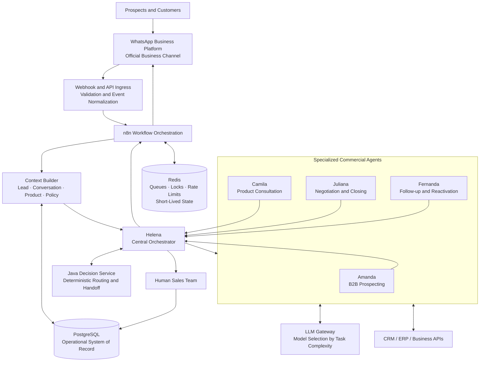
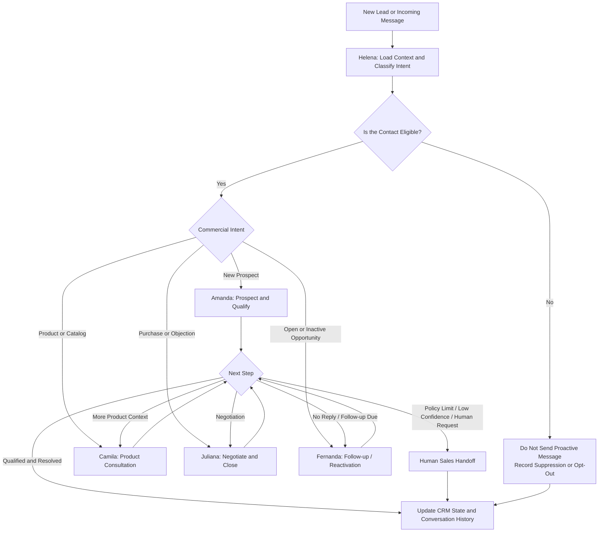
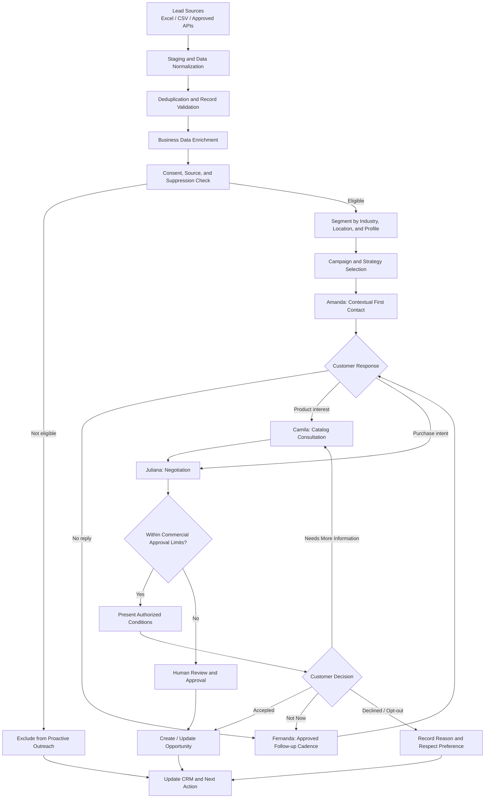
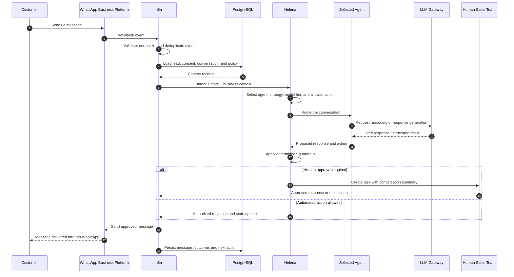
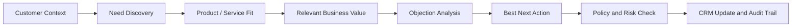
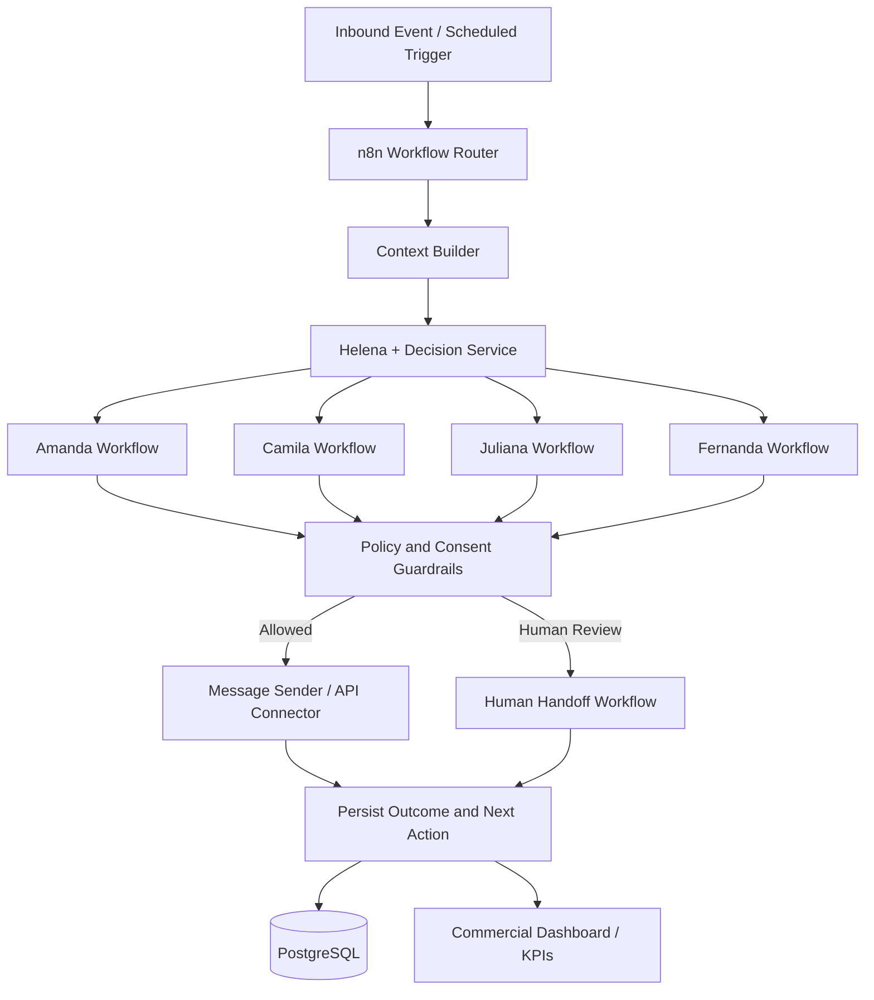
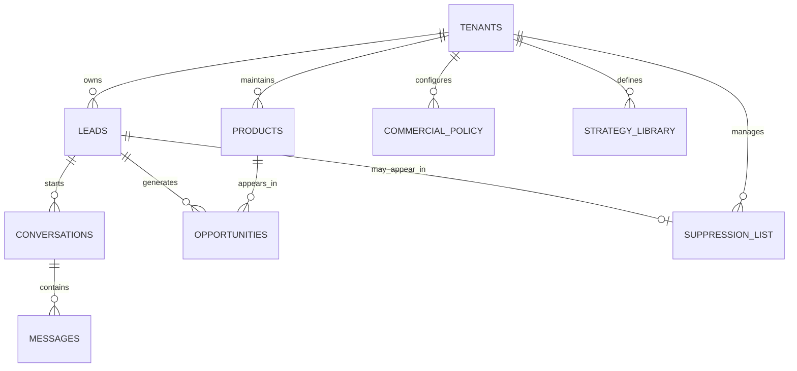
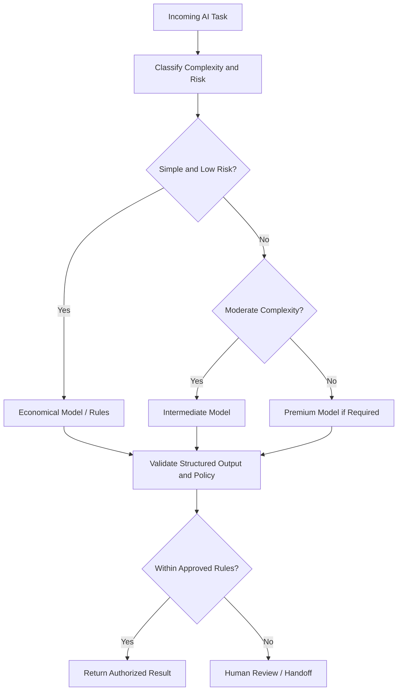
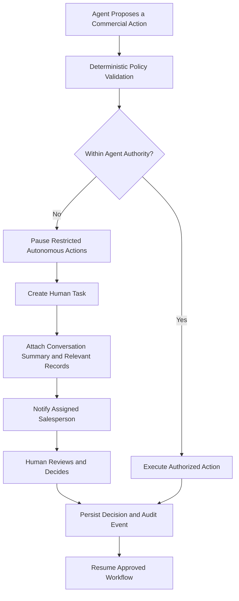

# GLASON.IA — B2B Commercial AI Orchestration Architecture (Multi-Agent)

<p align="center">
  <strong>Intelligent B2B Prospecting · Multi-Agent Sales Operations · Conversational AI · Workflow Automation</strong>
</p>

<p align="center">
  <em>A modular commercial AI platform designed to identify, qualify, engage, negotiate with, and reactivate B2B opportunities through coordinated AI agents.</em>
</p>

---

## 1. Project Overview

**GLASON.IA** is a multi-agent commercial automation platform designed to support B2B sales operations across the customer lifecycle — from lead intake and first contact to product consultation, negotiation, follow-up, and human handoff.

Instead of relying on one generic chatbot, GLASON.IA separates commercial responsibilities into specialized agents coordinated by a central orchestration layer. Each agent has a defined role, operating rules, conversation style, and handoff conditions. The orchestrator maintains the business context, selects the appropriate agent, applies commercial policies, and controls the next action.

The primary communication channel is the **WhatsApp Business Platform**. The architecture also includes workflow orchestration, relational data management, API-based integrations, model routing, and a path toward multi-company (multi-tenant) operation.

### Core objectives

- Automate eligible B2B prospecting and first-contact workflows.
- Enrich and organize lead records before commercial engagement.
- Qualify prospects using conversational context and configurable scoring rules.
- Present products using structured catalog data rather than unsupported assumptions.
- Handle objections and negotiation within configured commercial approval limits.
- Run contextual follow-up and opportunity reactivation workflows.
- Transfer conversations to a human salesperson when policy, risk, or customer intent requires it.
- Provide traceability for messages, decisions, opportunities, opt-outs, and operational metrics.

> **Architecture principle:** the objective is not to maximize message volume. It is to improve the quality of commercial conversations and the progression of qualified opportunities.

---

## 2. High-Level Architecture

The platform is organized around five cooperating layers:

1. **Communication layer** — WhatsApp Business Platform and webhook/API connectivity.
2. **Orchestration layer** — n8n workflows and Helena, the central decision-making orchestrator.
3. **Agent layer** — Amanda, Camila, Juliana, and Fernanda, each responsible for a sales function.
4. **Data and integration layer** — PostgreSQL, Redis, catalog data, CRM/ERP connectors, and external APIs.
5. **AI layer** — an LLM gateway that routes tasks according to complexity, cost, and risk.

### Logical platform architecture



*This is the logical reference architecture. Component deployment and production readiness must be evaluated against the implementation status described in Section 15.*

---

## 3. Multi-Agent Operating Model

GLASON.IA uses four specialized commercial agents and one central orchestrator. The agents are internal capabilities: the customer experience remains coherent while responsibility moves between agents.

| Agent | Responsibility | Main activities | Primary outcome |
|---|---|---|---|
| **Helena** | Orchestration and policy control | Classifies intent, reads conversation state, selects agent and strategy, applies guardrails, routes models, and decides when human intervention is required. | Correct next action with policy and context preserved. |
| **Amanda** | Prospecting and first contact | Opens eligible conversations, identifies the prospect's business context, asks discovery questions, and qualifies initial interest. | A relevant, permission-aware conversation and an initial qualification record. |
| **Camila** | Product consultation | Retrieves product/SKU information, explains product fit, compares options using customer criteria, and checks available catalog data. | A relevant product selection and documented buying requirements. |
| **Juliana** | Negotiation and closing | Understands purchase intent, quantity, timing, objections, and requested conditions; applies configured commercial limits. | A clear, verifiable proposal or a human handoff. |
| **Fernanda** | Follow-up and reactivation | Resumes conversations with context, follows approved cadence rules, reactivates open opportunities, and closes inactive cycles respectfully. | A meaningful next step, reactivation, or documented closure reason. |

### Agent handoff model



### Responsibility boundaries

- **Helena** owns routing and control; it is not another customer-facing sales persona.
- **Amanda** does not send a full catalog or a long institutional pitch without a reason.
- **Camila** must consult the product record before stating SKU specifications, stock, minimum quantities, or product characteristics.
- **Juliana** must not invent prices, margins, discounts, stock availability, or delivery commitments.
- **Fernanda** uses the real conversation history and configured cadence; it must honor opt-out requests immediately.

---

## 4. End-to-End B2B Sales Workflow

The intended sales lifecycle combines data preparation, eligibility checks, conversational qualification, product consultation, negotiation, and follow-up.



### Conversation processing sequence



---

## 5. Commercial Strategy Library

The project specification defines a **library of 50 configurable sales approaches**. These are not intended to be sent as fixed mass messages. Helena selects an approach based on segment, conversation state, customer intent, previous interactions, and campaign rules.

The strategy library covers, among other cases:

- Consultative opening and permission-based introductions.
- Segment and product-mix discovery.
- Catalog presentation and product recommendations.
- Lead qualification and buying-intent discovery.
- Price, delivery, supplier, and timing objections.
- Cross-selling and up-selling opportunities.
- High-intent, medium-intent, and low-intent lead handling.
- Follow-up, reactivation, and respectful conversation closure.
- Human handoff when a commercial decision exceeds agent authority.

### Sales reasoning framework



The system should optimize for a useful next step — not for the number of messages generated.

---

## 6. n8n Workflow Architecture

The n8n layer is organized as a set of specialized workflows rather than one oversized automation. This separation improves troubleshooting, observability, and the ability to scale or replace individual components.

| Workflow | Responsibility |
|---|---|
| `01_INBOUND_WHATSAPP` | Receives channel webhooks, validates and normalizes events, and prevents duplicate processing. |
| `02_CONTEXT_BUILDER` | Loads the lead, conversation summary, relevant catalog records, consent state, and commercial policy. |
| `03_HELENA_ORCHESTRATOR` | Classifies intent and selects the agent, strategy, model tier, and next action. |
| `04_AMANDA_PROSPECTION` | Handles eligible first-contact and prospect qualification workflows. |
| `05_CAMILA_PRODUCTS` | Retrieves product data and supports product consultation. |
| `06_JULIANA_NEGOTIATION` | Applies negotiation rules and creates or updates opportunities. |
| `07_FERNANDA_FOLLOWUP` | Schedules approved follow-ups and reactivation workflows. |
| `08_MESSAGE_SENDER` | Applies channel rules, sends authorized messages, and records provider status. |
| `09_HUMAN_HANDOFF` | Creates a human task with context and pauses autonomous actions where required. |
| `10_SUPPRESSION` | Handles opt-out and suppression rules to prevent further proactive contact. |
| `11_DASHBOARD` | Updates commercial indicators and operational reporting. |
| `12_IMPORT_LEADS` | Imports Excel/CSV records, normalizes phone numbers, validates data, and deduplicates leads. |

### Workflow orchestration view



---

## 7. Data Architecture and Contact Management

A key architectural decision is to separate the **contact repository** from the **active conversation context**. The agents should not load an entire contact database into memory. Each execution receives only the minimum relevant context required for the current decision.

### Core data entities

| Entity | Purpose | Example fields |
|---|---|---|
| `tenants` | Company/account boundaries for multi-tenant operation. | `tenant_id`, name, status |
| `leads` | Prospect identity and commercial state. | company, phone, segment, source, consent, opt-out, score, stage |
| `products` | Structured product catalog. | SKU, category, price, stock, minimum order quantity |
| `conversations` | Active and historical commercial sessions. | lead, assigned agent, intent, state |
| `messages` | Inbound and outbound message events. | provider ID, direction, body/reference, status, timestamp |
| `opportunities` | Qualified commercial opportunities. | lead, product, estimated value, probability, owner |
| `suppression_list` | Contacts that must not receive proactive outreach. | tenant, phone, reason, timestamp |
| `strategy_library` | Configurable sales approaches and campaign strategies. | strategy code, objective, eligibility, guidance |
| `commercial_policy` | Business rules and agent authority limits. | discount limits, minimum order, approval rules |

### Data relationship diagram



### Storage responsibilities

- **PostgreSQL** — durable operational records and the source of truth for leads, conversations, policies, and opportunities.
- **Redis** — short-lived state, locks, queue coordination, deduplication support, and rate limiting where deployed.
- **Object storage** — recommended for catalog media and message attachments; PostgreSQL should store metadata and private object references, not large media binaries.
- **Excel/CSV** — import, review, and export formats; not the operational database for a large contact repository.

The architecture uses **20M+ contact records as a capacity objective**, not as a measured production benchmark. Large-scale operation requires indexing, bulk ingestion, deduplication, tenant-scoped queries, partitioning of message history, and controlled queues.

---

## 8. AI Model Routing and Cost Control

Helena can route tasks through model classes according to the complexity and risk of the request. The design avoids using a premium model for every simple operation.

| Task | Preferred execution path |
|---|---|
| Greeting, intent classification, entity extraction | Lightweight model or deterministic rules |
| Product lookup | Catalog retrieval plus a lightweight response model |
| Lead qualification | Lightweight or intermediate model, depending on context |
| Common objections | Intermediate model |
| Complex negotiation or long-context reasoning | Premium model when justified |
| Price, discount, compliance, or financial limits | Deterministic policy checks; human review when outside authority |



Model routing must use authorized provider credentials, explicit fallback behavior, usage monitoring, and cost attribution. Provider limits must not be bypassed through unauthorized credential rotation.

---

## 9. Human-in-the-Loop and Commercial Guardrails

Autonomy is bounded by commercial rules. A human salesperson must be involved when a request exceeds configured authority or when the system cannot safely determine the correct action.

### Mandatory handoff scenarios

- A discount or payment condition exceeds the configured approval limit.
- A special commercial agreement requires authorization.
- The customer explicitly asks to speak with a person.
- A sensitive complaint or conflict requires human judgment.
- Data is inconsistent across connected systems.
- The agent has low confidence or encounters an unsupported request.
- A critical order change or final approval is required.

### Handoff sequence



A handoff should preserve the conversation context so the customer does not need to repeat information already provided.

---

## 10. WhatsApp, Consent, and Responsible Outreach

WhatsApp is the primary channel, but the channel is not a license for indiscriminate bulk messaging. **A contact repository containing millions of records does not mean every record is eligible for proactive contact.**

The platform design therefore treats consent and suppression as first-class data:

- Store contact source, consent state, and available consent evidence.
- Check eligibility before any proactive message.
- Maintain a suppression list and process opt-out requests immediately.
- Apply approved templates, business messaging rules, and frequency limits where required by the channel.
- Monitor delivery status, quality signals, blocks, complaints, and opt-out rates.
- Pause campaigns when error rates or channel quality signals exceed configured thresholds.
- Review Meta and WhatsApp Business policies before changing campaign purpose, templates, or scale.

All outreach must comply with applicable law, the platform's current policies, and the business's documented consent process. The implementation should use the official WhatsApp Business Platform for production business messaging where required by the operating model.

---

## 11. Security, Privacy, and Multi-Tenant Readiness

GLASON.IA is designed with a path toward a multi-company SaaS model. Each tenant must have isolated business data, catalog records, prompts, policies, credentials, users, and reporting scope.

Security principles include:

- TLS for data in transit and encryption at rest where supported.
- Secrets stored in environment-specific secret management, never in prompts or source control.
- Tenant-scoped database access and authorization checks on every business query.
- Role-based access control and least-privilege service credentials.
- Data minimization, configurable retention, and auditable deletion processes.
- Structured logs that exclude tokens, credentials, and unnecessary personal data.
- Backups with tested restoration procedures.
- Audit events for pricing, discounts, handoffs, opt-outs, and commercial-stage changes.
- Private object storage for media, with tenant checks and short-lived signed access where required.

Multi-tenant isolation and full production hardening are architecture requirements; they should not be treated as complete until validated with security and integration tests.

---

## 12. Observability and Business KPIs

The platform should measure commercial performance and operational reliability together.

| KPI | Definition |
|---|---|
| Eligible leads | Leads that satisfy current contact and campaign rules. |
| Response rate | Replies received divided by first-contact messages. |
| Useful response rate | Replies that contain classifiable commercial intent. |
| Qualification rate | Qualified leads divided by responding leads. |
| Catalog engagement | Prospects who request or receive relevant catalog material. |
| Quotations / opportunities | Qualified conversations that result in a quote or opportunity. |
| Human handoff rate | Conversations transferred to a human salesperson. |
| Conversion rate | Orders divided by qualified opportunities. |
| Attributed revenue | Order value associated with agent-assisted opportunities. |
| Opt-out rate | Contacts requesting that outreach stop. |
| AI cost per conversation | Model inference cost per conversation. |
| Cost per opportunity | AI and infrastructure cost divided by opportunities generated. |

Operational monitoring should also cover webhook failures, duplicate events, queue depth, worker health, API latency, message delivery status, retries, and model-provider errors.

---

## 13. Technology Stack

| Layer | Technology / component | Role |
|---|---|---|
| Workflow orchestration | **n8n** | Event-driven workflows, integrations, routing, and automation. |
| Decision service | **Java (JDK 21+)** | Reference implementation for deterministic intent routing, persona selection, scoring, and handoff decisions. |
| Operational database | **PostgreSQL** | Leads, conversations, messages, catalog, policies, and opportunities. |
| Queue and short-lived state | **Redis** | Queue coordination, locks, rate limits, and temporary state in the scale architecture. |
| Containerization | **Docker / Docker Compose** | Reproducible deployment and service isolation. |
| Business messaging | **WhatsApp Business Platform** | Official channel interface through API and webhooks. |
| AI | **LLM Gateway / model providers** | Language understanding, response generation, and task-specific reasoning. |
| Business integration | **REST APIs / Webhooks / CRM connectors** | Connectors to external business systems and sales tools. |

The model gateway is provider-oriented. Specific model providers and credentials should be configured for each deployment; this README does not imply that every available LLM provider is connected simultaneously.

---

## 14. Reference Implementation and Local Decision-Service Test

The engineering specification documents a Java reference decision service with `GET /health` and `POST /decision` endpoints, plus an importable n8n workflow skeleton and externalized persona configuration.

### Reference artifacts

- `src/GlasonAgent.java` — Java decision-service reference.
- `n8n/glason-commercial-core.json` — n8n workflow reference.
- `config/glason-personas.json` — persona definitions and orchestration configuration.
- `schema.sql` — relational data model reference.

### Run the Java reference service

Requires **JDK 21 or later**.

```bash
javac --add-modules jdk.httpserver -d out src/GlasonAgent.java
java --add-modules jdk.httpserver -cp out GlasonAgent
```

Health check:

```bash
curl http://localhost:<configured-port>/health
```

Decision endpoint:

```bash
curl -X POST http://localhost:8080/decision \
  -H "Content-Type: application/json" \
  -d '{
    "intent": "PRODUCT_INTEREST",
    "leadScore": 72,
    "conversationStage": "QUALIFICATION"
  }'
```

*The example payload is illustrative. Use the request schema defined by the actual Java implementation in the repository.*

### n8n workflow reference

The documented workflow skeleton covers webhook intake, data normalization, PostgreSQL lookup, a call to the Java decision service, handoff evaluation, opportunity creation, and an alert payload. Before production use, validate and complete the channel sender, webhook signature verification, complete message persistence, Redis coordination, retry/idempotency behavior, and consent enforcement.

---

## 15. Implementation Status and Engineering Boundaries

This section is intentional: a technical portfolio should distinguish a working reference implementation from a fully hardened production service.

### Documented reference implementation

- Java decision-service reference with health and decision endpoints.
- Importable n8n commercial-core workflow skeleton.
- Externalized JSON configuration for commercial personas.
- SQL schema reference for core business entities.
- Defined agent responsibilities, handoff rules, commercial playbooks, and target architecture.

### Production hardening and validation required

- Verify the WhatsApp webhook signature and inbound event authenticity.
- Complete official message sending and delivery-status tracking.
- Persist all required inbound and outbound message events.
- Add Redis-backed locking, deduplication, queue coordination, and tenant-level rate limits.
- Implement idempotent retries and recovery for API failures and duplicate/out-of-order events.
- Enforce consent, opt-out, suppression, template, and campaign-frequency policies end to end.
- Validate CRM/ERP synchronization and error reconciliation.
- Add automated integration tests, monitoring, alerting, and tested backup restoration.
- Benchmark ingestion, database queries, queue throughput, latency, and cost before increasing volume.

**Scale statement:** the 20M+ contact figure is an architectural capacity target. It is not presented as a measured benchmark or a claim that 20 million contacts can or should be messaged. Production throughput depends on infrastructure capacity, channel limits, consent eligibility, and measured account quality.

---

## 16. Roadmap

| Phase | Focus | Verifiable outcome |
|---|---|---|
| 0 — Baseline | Freeze source artifacts and dependencies. | Reproducible repository snapshot and setup notes. |
| 1 — Data foundation | PostgreSQL schema, Excel/CSV import, normalization, deduplication, suppression. | Clean lead ingestion with no duplicate normalized phone records. |
| 2 — Orchestration core | Helena, Amanda, initial strategies, deterministic routing, and audit logging. | Correct agent selection and traceable decisions. |
| 3 — Product intelligence | Camila, structured catalog, and product retrieval. | Product answers grounded in catalog data. |
| 4 — Negotiation | Juliana, commercial policy, opportunity records, and approval limits. | Authorized proposals and correct human escalation. |
| 5 — Follow-up | Fernanda, scheduling, cadence, reactivation, and opt-out handling. | Contextual follow-up with enforced contact preferences. |
| 6 — Channel integration | Official WhatsApp webhook, sender, templates, and delivery events. | End-to-end tested message lifecycle. |
| 7 — Controlled pilot | Small, consented contact cohort with human supervision. | Measured quality, delivery, latency, opt-out, and cost. |
| 8 — Scale and SaaS readiness | Queue workers, tenant isolation, observability, and deployment hardening. | Repeatable deployment and validated tenant boundaries. |

---

## 17. Project Value

GLASON.IA demonstrates an engineering approach to commercial AI beyond a single conversational interface:

- **Multi-agent architecture** with specialized responsibilities and a central orchestrator.
- **Workflow engineering** through modular n8n automations and API integration.
- **Deterministic business controls** around pricing, approval limits, consent, and human handoff.
- **Data architecture** designed to separate lead repositories from active conversational context.
- **Scalability planning** through PostgreSQL, Redis, worker queues, and tenant-aware data access.
- **Commercial intelligence** focused on lead qualification, product fit, objections, conversion, and cost per opportunity.

The project is relevant to roles involving **AI Engineering, AI Solutions Architecture, Multi-Agent Systems, Conversational AI, Sales Automation, and Enterprise Systems Integration**.

---

## Author

**Thiago Rafael de Souza Gomes**  
AI Solutions Architecture | Multi-Agent Systems | Business Process Automation | Systems Integration  
Santa Catarina, Brazil  

- GitHub: [@ProfThiagoRafael](https://github.com/ProfThiagoRafael)
- LinkedIn: [Thiago Rafael](https://www.linkedin.com/in/thiago-gomes-467aa717b/)

---

## Disclaimer

GLASON.IA is documented as an evolving engineering project. Architecture diagrams describe the logical design and target operating model; implementation status is explicitly identified in this README. No production-scale benchmark, conversion uplift, or service-level achievement is claimed unless supported by measured evidence.
